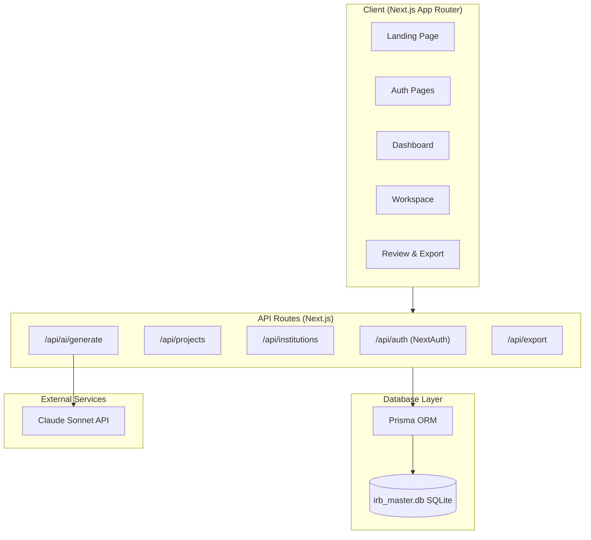
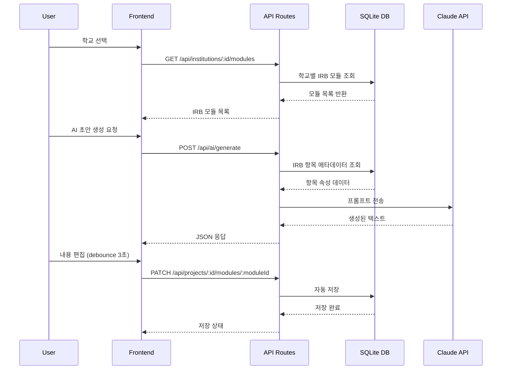

# Design Document: YourPark IRB SaaS

## Overview

YourPark는 연구자들이 IRB(기관생명윤리위원회) 심의 서류를 효율적으로 작성할 수 있도록 돕는 모듈형 SaaS 플랫폼입니다. 사용자는 소속 학교/기관을 선택하면 해당 기관의 IRB 기준에 맞는 항목이 동적으로 로드되고, Claude Sonnet AI를 활용해 각 항목별 문장 초안을 자동 생성할 수 있습니다.

핵심 가치:
- 학교별 IRB 기준 자동 적용으로 누락 항목 방지
- AI 기반 문장 초안 생성으로 작성 시간 단축
- 자동 저장 및 로컬 폴백으로 데이터 손실 방지
- DOCX/PDF 내보내기로 즉시 제출 가능한 서류 생성

기술 스택:
- **Frontend**: Next.js 14 (App Router) + TypeScript + Tailwind CSS
- **Backend**: Next.js API Routes
- **DB**: SQLite (irb_master.db) + Prisma ORM
- **Auth**: NextAuth.js (JWT 전략)
- **AI**: Anthropic Claude Sonnet API (`claude-sonnet-4-5`)
- **수식 렌더링**: KaTeX
- **내보내기**: docx + jsPDF
- **디자인**: Glassmorphism, 다크 네이비 테마 (기존 YourPark_landingpage 기반)

---

## Architecture

### 전체 시스템 구조



### 요청 흐름



### 인증 흐름

NextAuth.js의 JWT 전략을 사용합니다. 세션은 서버 사이드에서 검증되며, 미인증 사용자는 미들웨어에서 `/auth/login`으로 리다이렉트됩니다.

```mermaid
flowchart LR
    A[요청] --> B{미들웨어 인증 확인}
    B -->|인증됨| C[페이지 렌더링]
    B -->|미인증| D[/auth/login 리다이렉트]
    D --> E[로그인/회원가입]
    E --> F[JWT 발급]
    F --> C
```

---

## Components and Interfaces

### 페이지 구조 (App Router)

```
app/
├── page.tsx                    # Landing Page
├── auth/
│   ├── login/page.tsx
│   └── register/page.tsx
├── dashboard/
│   └── page.tsx
├── projects/
│   ├── new/page.tsx            # 학교 선택 + 모듈 선택
│   └── [id]/
│       ├── workspace/page.tsx  # 편집 워크스페이스
│       └── review/page.tsx     # 최종 검토 + 내보내기
└── api/
    ├── auth/[...nextauth]/route.ts
    ├── projects/
    │   ├── route.ts            # GET, POST
    │   └── [id]/
    │       ├── route.ts        # GET, PATCH, DELETE
    │       └── modules/[moduleId]/route.ts  # PATCH
    ├── institutions/
    │   ├── route.ts            # GET (목록)
    │   └── [id]/modules/route.ts  # GET (모듈 목록)
    ├── ai/generate/route.ts
    └── export/route.ts
```

### 핵심 컴포넌트

#### `ModuleCard`
워크스페이스의 개별 IRB 항목 카드. Glassmorphism 스타일 적용.

```typescript
interface ModuleCardProps {
  module: ProjectModule;
  onContentChange: (moduleId: string, content: string) => void;
  onGenerateAI: (moduleId: string, keywords: string) => Promise<void>;
  saveStatus: 'idle' | 'saving' | 'saved' | 'error';
}
```

#### `AIGenerateButton`
Claude API 호출을 트리거하는 버튼. 로딩 상태 및 오류 처리 포함.

#### `SaveStatusIndicator`
"저장 중...", "저장됨", "저장 실패" 세 가지 상태를 표시하는 인디케이터.

#### `FormulaRenderer`
KaTeX를 사용하여 수식이 포함된 IRB 항목(표본 크기 계산 등)을 렌더링.

#### `ExportButton`
DOCX 또는 PDF 형식으로 최종 서류를 내보내는 버튼.

### API 인터페이스

#### `POST /api/ai/generate`
```typescript
// Request
interface AIGenerateRequest {
  projectId: string;
  moduleId: string;
  keywords: string;
  moduleMetadata: {
    name: string;
    description: string;
    category: string;
  };
}

// Response
interface AIGenerateResponse {
  content: string;
  moduleId: string;
  generatedAt: string;
}
```

#### `PATCH /api/projects/:id/modules/:moduleId`
```typescript
// Request
interface ModuleUpdateRequest {
  content: string;
}

// Response
interface ModuleUpdateResponse {
  id: string;
  content: string;
  updatedAt: string;
}
```

---

## Data Models

### Prisma Schema

```prisma
model User {
  id        String   @id @default(cuid())
  email     String   @unique
  password  String   // bcrypt 해시
  name      String?
  createdAt DateTime @default(now())
  updatedAt DateTime @updatedAt
  projects  Project[]
}

model Institution {
  id          String           @id @default(cuid())
  name        String           @unique
  shortName   String?
  modules     InstitutionModule[]
  projects    Project[]
}

model IRBModule {
  id          String   @id @default(cuid())
  name        String
  description String
  category    String
  isRequired  Boolean  @default(false)
  order       Int
  hasFormula  Boolean  @default(false)
  promptHint  String?  // AI 프롬프트 생성 힌트
  institutionModules InstitutionModule[]
  projectModules     ProjectModule[]
}

model InstitutionModule {
  id            String      @id @default(cuid())
  institution   Institution @relation(fields: [institutionId], references: [id])
  institutionId String
  module        IRBModule   @relation(fields: [moduleId], references: [id])
  moduleId      String
  priority      Int         // 학교별 우선순위
  isRequired    Boolean     @default(false)

  @@unique([institutionId, moduleId])
}

model Project {
  id            String          @id @default(cuid())
  name          String
  user          User            @relation(fields: [userId], references: [id])
  userId        String
  institution   Institution     @relation(fields: [institutionId], references: [id])
  institutionId String
  status        ProjectStatus   @default(DRAFT)
  createdAt     DateTime        @default(now())
  updatedAt     DateTime        @updatedAt
  modules       ProjectModule[]
}

model ProjectModule {
  id        String    @id @default(cuid())
  project   Project   @relation(fields: [projectId], references: [id], onDelete: Cascade)
  projectId String
  module    IRBModule @relation(fields: [moduleId], references: [id])
  moduleId  String
  content   String    @default("")
  order     Int
  updatedAt DateTime  @updatedAt

  @@unique([projectId, moduleId])
}

enum ProjectStatus {
  DRAFT
  IN_PROGRESS
  COMPLETED
}
```

### IRB_Master_DB 시드 데이터 구조

`irb_master.db`는 Prisma 마이그레이션으로 생성되며, 초기 시드 스크립트(`prisma/seed.ts`)로 IRB 항목 데이터를 로드합니다.

```typescript
// IRBModule 시드 예시
const irbModules = [
  {
    name: "연구 목적 및 필요성",
    description: "연구의 목적, 배경, 필요성을 기술",
    category: "기본정보",
    isRequired: true,
    order: 1,
    hasFormula: false,
    promptHint: "연구 목적, 사회적 필요성, 기대 효과를 포함하여 작성"
  },
  {
    name: "표본 크기 계산",
    description: "통계적 근거에 기반한 연구 대상자 수 산출",
    category: "연구방법",
    isRequired: true,
    order: 5,
    hasFormula: true,
    promptHint: "검정력, 유의수준, 효과크기를 포함한 표본 크기 계산식 제시"
  },
  // ... 추가 모듈
];
```

### 자동 저장 로직

```typescript
// debounce 3초 자동 저장 + localStorage 폴백
const useAutoSave = (projectId: string, moduleId: string) => {
  const [saveStatus, setSaveStatus] = useState<SaveStatus>('idle');

  const save = useDebouncedCallback(async (content: string) => {
    setSaveStatus('saving');
    try {
      await fetch(`/api/projects/${projectId}/modules/${moduleId}`, {
        method: 'PATCH',
        body: JSON.stringify({ content }),
      });
      localStorage.removeItem(`draft_${projectId}_${moduleId}`);
      setSaveStatus('saved');
    } catch {
      localStorage.setItem(`draft_${projectId}_${moduleId}`, content);
      setSaveStatus('error');
    }
  }, 3000);

  return { save, saveStatus };
};
```

---

## Correctness Properties

*A property is a characteristic or behavior that should hold true across all valid executions of a system — essentially, a formal statement about what the system should do. Properties serve as the bridge between human-readable specifications and machine-verifiable correctness guarantees.*


### Property 1: 회원가입 round-trip

*For any* 유효한 이메일과 비밀번호 조합에 대해, 회원가입 API를 호출한 후 해당 이메일로 로그인을 시도하면 인증 토큰이 발급되어야 한다.

**Validates: Requirements 2.1, 2.2**

### Property 2: 잘못된 자격증명 거부

*For any* 등록되지 않은 이메일 또는 잘못된 비밀번호 조합에 대해, 로그인 API는 오류 응답을 반환해야 하며 토큰을 발급하지 않아야 한다.

**Validates: Requirements 2.3, 2.4**

### Property 3: 로그아웃 후 토큰 무효화

*For any* 인증된 사용자에 대해, 로그아웃 후 해당 토큰으로 보호된 API를 호출하면 401 응답이 반환되어야 한다.

**Validates: Requirements 2.5**

### Property 4: 미인증 접근 차단

*For any* 보호된 경로(Dashboard, Workspace)에 대해, 유효한 인증 토큰 없이 접근하면 로그인 페이지로 리다이렉트되어야 한다.

**Validates: Requirements 2.6**

### Property 5: 프로젝트 카드 필수 정보 포함

*For any* 사용자의 프로젝트 목록에 대해, 각 프로젝트 카드를 렌더링한 결과는 프로젝트명, 선택된 학교, 마지막 수정 일시, 진행 상태를 모두 포함해야 한다.

**Validates: Requirements 3.2**

### Property 6: 프로젝트 삭제 후 목록에서 제거

*For any* 프로젝트에 대해, 삭제 API를 호출한 후 프로젝트 목록 API를 조회하면 해당 프로젝트가 목록에 존재하지 않아야 한다.

**Validates: Requirements 3.5**

### Property 7: 학교별 IRB 모듈 로딩

*For any* Institution_DB에 등록된 학교에 대해, 해당 학교의 모듈 목록 API는 비어 있지 않은 IRB 모듈 목록을 반환해야 하며, 각 모듈은 name, description, isRequired, order 필드를 포함해야 한다.

**Validates: Requirements 4.2**

### Property 8: 선택된 모듈 저장 및 Workspace 이동

*For any* 모듈 선택 목록에 대해, 프로젝트 생성 API를 호출한 후 해당 프로젝트를 조회하면 선택된 모듈들이 ProjectModule로 저장되어 있어야 한다.

**Validates: Requirements 4.5**

### Property 9: Workspace 카드 렌더링

*For any* 프로젝트의 모듈 목록에 대해, Workspace를 렌더링한 결과는 각 모듈에 대응하는 카드를 포함해야 하며, 카드 수는 모듈 수와 동일해야 한다.

**Validates: Requirements 5.1**

### Property 10: AI 생성 요청 파라미터 검증

*For any* 모듈 ID와 키워드 조합에 대해, AI 생성 API에 전달되는 프롬프트는 해당 키워드와 모듈의 메타데이터(name, promptHint)를 포함해야 한다.

**Validates: Requirements 5.3, 6.1, 6.4**

### Property 11: AI 응답 JSON 형식

*For any* AI 생성 요청에 대해, AI_Generator의 응답은 content와 moduleId 필드를 포함하는 유효한 JSON 형식이어야 한다.

**Validates: Requirements 5.4, 6.3**

### Property 12: 자동 저장 debounce

*For any* 편집 이벤트에 대해, 마지막 입력으로부터 3초가 경과하면 저장 API가 정확히 한 번 호출되어야 하며, 3초 이내의 연속 입력에 대해서는 저장 API가 호출되지 않아야 한다.

**Validates: Requirements 5.7, 8.1**

### Property 13: 저장 상태 전환

*For any* 저장 시도에 대해, 저장 시작 시 "저장 중..." 상태로 전환되고, 성공 시 "저장됨", 실패 시 "저장 실패" 상태로 전환되어야 한다.

**Validates: Requirements 8.2**

### Property 14: 네트워크 오류 시 localStorage 폴백

*For any* 편집 내용에 대해, 저장 API 호출이 실패하면 해당 내용이 localStorage에 저장되어야 하며, 이후 localStorage에서 해당 내용을 조회할 수 있어야 한다.

**Validates: Requirements 8.3**

### Property 15: 네트워크 복구 후 동기화

*For any* localStorage에 임시 저장된 데이터에 대해, 네트워크 복구 이벤트 발생 후 해당 데이터가 서버 API를 통해 동기화되면 서버에서 동일한 내용을 조회할 수 있어야 한다.

**Validates: Requirements 8.4, 8.5**

### Property 16: 검토 페이지 모듈 순서

*For any* 프로젝트에 대해, 최종 검토 페이지에 표시되는 모듈 목록은 IRBModule의 order 필드 기준으로 오름차순 정렬되어야 한다.

**Validates: Requirements 7.1**

### Property 17: 미완성 항목 감지

*For any* 프로젝트 모듈 목록에 대해, content가 빈 문자열이거나 공백만으로 구성된 모듈은 미완성으로 분류되어야 하며, 미완성 모듈이 하나라도 있으면 미완성 항목 경고가 표시되어야 한다.

**Validates: Requirements 7.4**

### Property 18: 내보내기 파일 생성

*For any* 완성된 프로젝트에 대해, 내보내기 API를 호출하면 DOCX 또는 PDF 형식의 파일이 생성되어야 하며, 파일은 모든 모듈의 내용을 포함해야 한다.

**Validates: Requirements 7.3**

### Property 19: IRB 데이터 파싱 유효성

*For any* 유효한 IRB 항목 데이터(name, description, category, isRequired, order 필드 포함)에 대해, 파싱 함수는 오류 없이 IRBModule 객체를 반환해야 한다.

**Validates: Requirements 10.1**

### Property 20: 유효하지 않은 데이터 오류 반환

*For any* 필수 필드(name, category, order)가 누락된 IRB 항목 데이터에 대해, 파싱 함수는 누락된 필드 정보를 포함한 오류를 반환해야 한다.

**Validates: Requirements 10.2**

### Property 21: Pretty_Printer 출력 포함 필드

*For any* IRBModule 객체에 대해, Pretty_Printer의 출력 문자열은 해당 모듈의 name, description, category 값을 포함해야 한다.

**Validates: Requirements 10.3**

### Property 22: IRB 데이터 파싱 round-trip

*For any* 유효한 IRBModule 객체에 대해, Pretty_Printer로 출력한 결과를 다시 파싱하면 원본 객체와 동등한 객체가 생성되어야 한다.

**Validates: Requirements 10.4**

---

## Error Handling

### 인증 오류
- 만료된 JWT 토큰: 401 응답 + 로그인 페이지 리다이렉트
- 잘못된 자격증명: 400 응답 + 구체적인 오류 메시지 (보안상 이메일/비밀번호 중 어느 것이 틀렸는지 구분하지 않음)
- 중복 이메일: 409 응답 + "이미 사용 중인 이메일입니다" 메시지

### AI API 오류
- Claude API 타임아웃 (30초): 504 응답 + "AI 초안 생성에 실패했습니다. 다시 시도해 주세요." 메시지
- Claude API 오류 (4xx/5xx): 502 응답 + 동일 메시지
- 재시도 전략: 지수 백오프로 최대 2회 재시도

### 데이터베이스 오류
- 학교 데이터 로드 실패: "학교 정보를 불러오는 데 실패했습니다. 다시 시도해 주세요." 메시지
- 저장 실패: localStorage 폴백 + "저장 실패 - 로컬에 임시 저장됨" 메시지

### 내보내기 오류
- 미완성 항목 존재: "미완성 항목이 있습니다. 계속 진행하시겠습니까?" 확인 다이얼로그
- 파일 생성 실패: "내보내기에 실패했습니다. 다시 시도해 주세요." 메시지

### 전역 오류 처리
- Next.js `error.tsx`를 사용한 페이지 레벨 오류 경계
- API Routes에서 일관된 오류 응답 형식:
  ```typescript
  interface ErrorResponse {
    error: string;
    message: string;
    details?: unknown;
  }
  ```

---

## Testing Strategy

### 이중 테스트 접근법

단위 테스트와 속성 기반 테스트를 함께 사용하여 포괄적인 커버리지를 확보합니다.

**단위 테스트** (Vitest + React Testing Library):
- 특정 예시 및 엣지 케이스 검증
- 컴포넌트 렌더링 및 인터랙션 테스트
- API Route 핸들러 테스트 (MSW로 외부 API 모킹)
- 오류 조건 및 경계 케이스

**속성 기반 테스트** (fast-check):
- 보편적 속성 검증 (임의의 입력에 대해 성립해야 하는 규칙)
- 각 속성 테스트는 최소 100회 반복 실행
- 각 테스트에 설계 문서 속성 참조 태그 포함

### 속성 기반 테스트 설정

```typescript
// 예시: Property 22 - IRB 데이터 파싱 round-trip
import fc from 'fast-check';
import { parseIRBModule, prettyPrintIRBModule } from '@/lib/irb';

// Feature: yourpark-irb-saas, Property 22: IRB 데이터 파싱 round-trip
test('IRB 모듈 파싱 round-trip', () => {
  fc.assert(
    fc.property(
      fc.record({
        name: fc.string({ minLength: 1 }),
        description: fc.string(),
        category: fc.string({ minLength: 1 }),
        isRequired: fc.boolean(),
        order: fc.integer({ min: 1 }),
        hasFormula: fc.boolean(),
      }),
      (moduleData) => {
        const parsed = parseIRBModule(moduleData);
        const printed = prettyPrintIRBModule(parsed);
        const reparsed = parseIRBModule(printed);
        return JSON.stringify(parsed) === JSON.stringify(reparsed);
      }
    ),
    { numRuns: 100 }
  );
});
```

### 테스트 태그 형식

각 속성 기반 테스트는 다음 형식의 주석을 포함해야 합니다:
```
// Feature: yourpark-irb-saas, Property {번호}: {속성 설명}
```

### 단위 테스트 우선순위

단위 테스트는 다음에 집중합니다:
- 랜딩 페이지 CTA 버튼 렌더링 및 네비게이션 (Requirements 1.2, 1.3, 1.5, 1.6)
- 로그인/회원가입 폼 유효성 검사 (Requirements 2.1~2.4)
- 대시보드 프로젝트 카드 렌더링 (Requirements 3.1~3.4)
- AI 생성 타임아웃 처리 (Requirements 6.5)
- 미완성 항목 다운로드 경고 (Requirements 7.5)
- 학교 데이터 로드 오류 처리 (Requirements 4.6)

### 속성 기반 테스트 우선순위

속성 기반 테스트는 다음 속성에 집중합니다:
- Property 1, 2, 3, 4: 인증 시스템 전반
- Property 12, 13, 14, 15: 자동 저장 및 데이터 영속성
- Property 19, 20, 21, 22: IRB 데이터 파싱 및 직렬화
- Property 10, 11: AI 생성 요청/응답 형식
